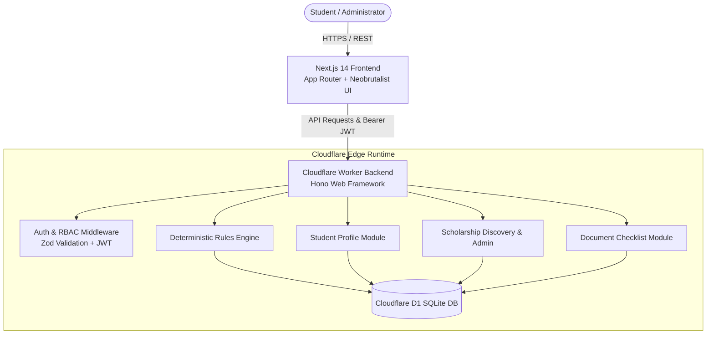

# Qualify — Deterministic Scholarship Eligibility Portal

[](https://nextjs.org/)
[](https://workers.cloudflare.com/)
[](https://hono.dev/)
[](https://developers.cloudflare.com/d1/)
[](https://www.typescriptlang.org/)
[](https://tailwindcss.com/)

> **Find Scholarships. Understand The Rules. Zero Guesswork.**  
> A transparent, rule-by-rule scholarship discovery and eligibility verification platform featuring verified official notices, auditable rules evaluation, and dynamic document checklists.

---

## 🎯 Overview

Most scholarship portals operate either as static bulletin boards with outdated information or as opaque systems with black-box recommendation algorithms. Students waste hours preparing documents for schemes they are not eligible for or miss opportunities due to confusing criteria.

**Qualify** replaces guesswork with a **deterministic rules engine**:
* **100% Rule Transparency**: Every eligibility criterion (minimum GPA, family income limits, academic level, domicile state, social category, gender, course restrictions) is evaluated individually with clear `PASS` / `FAIL` statuses and human-readable explanations.
* **Document Readiness Tracker**: Interactive checklist per scholarship that helps students verify and prepare every mandatory document (income certificates, marksheets, bonafide letters, caste certificates).
* **Auditable Official Notices**: Direct links to authentic government and institutional notification PDFs, portal links, and verified deadline counters.
* **Admin Management Portal**: Administrative tools featuring a no-code Rule Builder and Document Requirement Editor for creating and managing scholarship schemes.

---

## 🛠 Tech Stack

| Layer | Technology | Description |
| :--- | :--- | :--- |
| **Frontend** | [Next.js 14](https://nextjs.org/) (App Router) | React Server Components, client-side routing, and static/dynamic rendering |
| **Frontend UI** | [Tailwind CSS](https://tailwindcss.com/) & [Lucide React](https://lucide.dev/) | Custom Neobrutalist design system with high-contrast accessibility |
| **Backend API** | [Hono](https://hono.dev/) | Ultra-fast web framework running on Cloudflare Workers edge runtime |
| **Edge Compute** | [Cloudflare Workers](https://workers.cloudflare.com/) | Serverless edge deployment with low-latency global execution |
| **Database** | [Cloudflare D1](https://developers.cloudflare.com/d1/) | Serverless relational SQLite database at the edge |
| **Validation & Auth** | [Zod](https://zod.dev/) & [jose](https://github.com/panva/jose) | Strict request schema validation and stateless JWT authentication |
| **Testing** | [Vitest](https://vitest.dev/) | Automated unit and integration testing suite for rules engine & API |

---

## 🏛 System Architecture



---

## ✨ Key Features

### 1. Deterministic Rule Engine
* Evaluates candidate qualifications against scholarship rules using deterministic comparison operators (`EQUALS`, `NOT_EQUALS`, `GREATER_THAN_OR_EQUAL`, `LESS_THAN_OR_EQUAL`, `IN_LIST`, `CONTAINS`).
* Returns detailed per-rule evaluation outcomes:
  * Parameter name & user's actual value
  * Requirement operator & threshold
  * Plain-English explanation of why the rule passed or failed.

### 2. Document Preparation Checklist
* Tracks student preparation progress for required documents.
* Real-time completion percentage.
* Persistent state per student per scholarship.

### 3. Multi-Faceted Directory & Search
* Instant keyword search across scholarship titles, providers, and descriptions.
* Filter by:
  * Academic Level (Undergraduate, Postgraduate, Diploma, PhD, High School)
  * Domicile State / Regional eligibility
  * Social Category (General, OBC, SC, ST, EWS)
  * Minimum Scholarship Amount & Deadline urgency
* Export filtered scholarship listings to CSV.

### 4. Admin Scholarship Portal & Rule Builder
* Visual rule builder supporting custom parameters, comparison operators, and threshold values.
* Document requirement editor specifying mandatory vs. optional documents.
* Direct official notice linking and application portal URL configuration.

### 5. Role-Based Access Control (RBAC)
* Separate roles for `student` and `admin`.
* Protected API endpoints and frontend route guards.

---

## 📂 Project Structure

```text
qualify/
├── backend/
│   ├── migrations/                 # Cloudflare D1 SQL schema & seeds
│   │   ├── 0001_initial_schema.sql # Tables: users, profiles, scholarships, rules, documents, checklist
│   │   └── 0002_seed_data.sql      # 12+ preloaded real-world scholarships & demo accounts
│   ├── scripts/
│   │   └── generate-seed-sql.mjs   # Generates seed SQL from TypeScript definitions
│   ├── src/
│   │   ├── index.ts                # Hono application root, CORS & error handlers
│   │   ├── middleware/             # JWT authentication and admin guards
│   │   ├── modules/
│   │   │   ├── auth/               # Login, register, session verification
│   │   │   ├── checklist/          # Student document checklist API
│   │   │   ├── profile/            # Student profile CRUD
│   │   │   ├── rules-engine/       # Deterministic rule parser & evaluator
│   │   │   └── scholarships/       # Scholarship CRUD, search, filter, CSV
│   │   ├── seeds/                  # Seed dataset (12 scholarships & demo users)
│   │   ├── types/                  # Shared TypeScript interfaces & types
│   │   └── utils/                  # Cryptography and JWT helpers
│   ├── test/                       # Vitest integration and unit tests
│   └── wrangler.jsonc              # Cloudflare Worker configuration & D1 binding
│
├── frontend/
│   ├── public/                     # Static assets & icons
│   ├── src/
│   │   ├── app/                    # Next.js App Router pages
│   │   │   ├── admin/              # Admin dashboard & scholarship creation
│   │   │   ├── login/              # Authentication login page
│   │   │   ├── profile/            # Student profile onboarding & editor
│   │   │   ├── register/           # Student registration page
│   │   │   ├── scholarships/       # Scholarship directory & detail pages
│   │   │   ├── layout.tsx          # Root layout with Navbar and Footer
│   │   │   └── page.tsx            # Landing page with feature showcases
│   │   ├── components/             # Reusable UI components & Neobrutalist widgets
│   │   │   ├── admin/              # Rule builder & document editor components
│   │   │   ├── common/             # Navbar, Footer, RouteGuard
│   │   │   ├── scholarships/       # Filter sidebar, eligibility widget, checklist
│   │   │   └── ui/                 # Buttons, Cards, Inputs, Dialogs, Badges
│   │   ├── context/                # Authentication context & state
│   │   ├── data/                   # Fallback mock scholarships for offline/preview
│   │   ├── hooks/                  # Custom React hooks (profile, store, checklist)
│   │   ├── lib/                    # API client, CSV exporter, eligibility evaluator
│   │   └── types/                  # Frontend TypeScript definitions
│   ├── tailwind.config.ts          # Neobrutalist styling configuration
│   └── tsconfig.json               # TypeScript configuration
│
├── TASKS.md                        # Comprehensive roadmap & technical implementation specification
└── README.md                       # Project documentation
```

---

## 🚀 Getting Started

### Prerequisites

Ensure you have the following installed:
* [Node.js](https://nodejs.org/) (v18.0.0 or higher)
* [npm](https://www.npmjs.com/) (v9.0.0 or higher)
* [Wrangler CLI](https://developers.cloudflare.com/workers/wrangler/) (installed automatically as dev dependency or globally via `npm install -g wrangler`)

---

### 1. Clone the Repository

```bash
git clone https://github.com/avinashboruah/qualify.git
cd qualify
```

---

### 2. Backend Setup (Cloudflare Worker + D1)

```bash
cd backend

# Install dependencies
npm install

# Initialize local SQLite D1 database and apply migrations + seed data
npm run db:setup

# Start local Cloudflare Worker development server (runs on http://localhost:8787)
npm run dev
```

#### Backend Useful Commands

```bash
npm run dev              # Run worker locally with Hot Reload
npm run db:migrate       # Apply schema migrations locally
npm run db:seed          # Seed mock scholarships and demo accounts locally
npm run db:setup         # Execute migration + seed sequentially
npm test                 # Run automated tests with Vitest
npm run deploy           # Deploy Cloudflare Worker to production
```

---

### 3. Frontend Setup (Next.js)

Open a new terminal window:

```bash
cd frontend

# Install dependencies
npm install

# (Optional) Create environment file if targeting a custom backend URL
echo "NEXT_PUBLIC_API_URL=http://localhost:8787" > .env.local

# Start Next.js development server (runs on http://localhost:3000)
npm run dev
```

Visit **`http://localhost:3000`** in your browser.

---

## 🔑 Demo Credentials

For quick testing and evaluation, the database comes pre-seeded with sample accounts:

| Role | Email | Password | Access Level / Description |
| :--- | :--- | :--- | :--- |
| **Administrator** | `admin@scholarships.gov.in` | `Admin@12345` | Full administrative privileges, create scholarships, manage rules |
| **Student** | `student1@test.com` | `Student@12345` | Pre-filled profile (B.Tech, 8.4 CGPA, Assam domicile, General category) |
| **New Student** | `student2@test.com` | `Student@12345` | Blank profile to test the onboarding and eligibility flow |

> ⚡ **Tip:** The frontend login page includes instant **"Quick Demo Login"** buttons to log in with a single click.

---

## 📋 API Endpoints

### Authentication
* `POST /api/auth/register` — Register a new student account
* `POST /api/auth/login` — Authenticate and receive JWT token
* `GET /api/auth/me` — Retrieve active user session and role

### Student Profile
* `GET /api/profile` — Fetch authenticated student profile
* `PUT /api/profile` — Create or update academic & socioeconomic profile

### Scholarships
* `GET /api/scholarships` — Search and filter scholarships (category, state, level, amount)
* `GET /api/scholarships/:id` — Get detailed scholarship info with rules and documents
* `GET /api/scholarships/:id/evaluate` — Deterministic eligibility check against student profile
* `GET /api/scholarships/export/csv` — Export scholarship catalog to CSV

### Document Checklist
* `GET /api/scholarships/:id/checklist` — Get student's document preparation status
* `PATCH /api/scholarships/:id/checklist` — Toggle document readiness (`pending` / `prepared`)

### Administrator (Requires Admin Role)
* `POST /api/admin/scholarships` — Create a new scholarship with rules and document requirements
* `PUT /api/admin/scholarships/:id` — Update scholarship details, rules, and documents
* `DELETE /api/admin/scholarships/:id` — Delete a scholarship entry

---

## 🧪 Testing

Run automated tests to verify the deterministic rules engine and API handlers:

```bash
cd backend
npm test
```

The test suite covers:
* Strict numeric threshold comparisons (CGPA, Family Income, Age limits)
* Multi-select and array-membership validations (Domicile State, Caste Category)
* Exact equality checks (Gender, Education Level, Course of Study)
* Deterministic eligibility failure reason generation
* Authentication middleware and JWT validation

---

## 🤝 Contributing

1. Fork the Project
2. Create your Feature Branch (`git checkout -b feature/amazing-feature`)
3. Commit your Changes (`git commit -m 'feat: add amazing feature'`)
4. Push to the Branch (`git push origin feature/amazing-feature`)
5. Open a Pull Request

---

## 📄 License

This project is licensed under the MIT License - see the LICENSE file for details.
